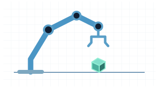

# Xiaoqian Zhang

Shawno (张啸谦) · M.S. student at **Shanghai Jiao Tong University**.

I study medical image representations and build research software.

> **Now:** Working on embodied AI.

[Website](https://xiaoqian-zhang-shawno.github.io/) · [ORCID](https://orcid.org/0009-0004-5587-2188) · [Google Scholar](https://scholar.google.co.jp/citations?user=maQlQdIAAAAJ&hl=zh-CN) · [Email](mailto:xiaoqian_shawno@sjtu.edu.cn)

## Selected research&nbsp;

 **— [VQPET](https://doi.org/10.1109/TMI.2026.3657118)** · 2026  
Vector-quantized codebook priors for PET image synthesis.

 **— [MoMIL](https://doi.org/10.1016/j.imavis.2026.105918)** · 2026  
Multi-order multiple instance learning for computational pathology.

 **— [Photoacoustic–ultrasound fusion](https://doi.org/10.26599/AUDT.2025.250103)** · Review · 2025  
A review of technical progress and clinical translation in breast cancer imaging.

[All publications and author lists](https://xiaoqian-zhang-shawno.github.io/publications/)

## Selected software&nbsp;

<!-- Star counts checked against GitHub on 2026-11-06. -->

 **— [JoFoundry](https://github.com/Xiaoqian-Zhang-Shawno/JoFoundry)**&nbsp;·&nbsp;[★&nbsp;0](https://github.com/Xiaoqian-Zhang-Shawno/JoFoundry/stargazers "JoFoundry stargazers")  
Local multi-model research workspace with staged evidence review, resumable goals, and bilingual manuscript drafts.

 **— [Notion&nbsp;Research&nbsp;Digest](https://github.com/Xiaoqian-Zhang-Shawno/notion-monthly-research)**&nbsp;·&nbsp;[★&nbsp;3](https://github.com/Xiaoqian-Zhang-Shawno/notion-monthly-research/stargazers "notion-monthly-research stargazers")  
Collects arXiv papers and turns them into a recurring literature digest in Notion.

 **— [BetDogEye](https://github.com/Xiaoqian-Zhang-Shawno/BetDogEye)**&nbsp;·&nbsp;[★&nbsp;1](https://github.com/Xiaoqian-Zhang-Shawno/BetDogEye/stargazers "BetDogEye stargazers")  
Local web app for tracking sports bets and visualizing portfolio risk.

[All software projects](RESEARCH_SOFTWARE.md)

  <em>Worked in sim. The cube has other plans.</em>
  &nbsp;
  

## Education & work&nbsp;

- **Beihang University** · 2021–2025 — B.E. in Biomedical Engineering.
- **BGI Research Institute** · Jun–Nov 2024 — Research internship in spatial transcriptomics and tissue image analysis.
- **Shanghai Jiao Tong University** · 2025–2028 (expected) — M.S. in Medical Imaging Technology.
- **Momenta** · Oct–Dec 2025 — Algorithm internship in multi-camera BEV perception and temporal evaluation.
- **United Imaging Surgical** · Jul–Dec 2026 (expected) — Internship in multi-view endoscopic reconstruction.

## Highlights&nbsp;

- **Graduate scholarships** — First-Class Graduate Scholarship, Shanghai Jiao Tong University, in both 2025–2026 and 2026–2027.
- **Undergraduate scholarship** — First-Class Scholarship, Beihang University (2021–2022).
- **Biomedical design** — National third prize for a team project on multimodal Raman and photoelectric sensing for early cervical cancer detection. [2024 competition results](https://news.buaa.edu.cn/info/1005/63065.htm)
